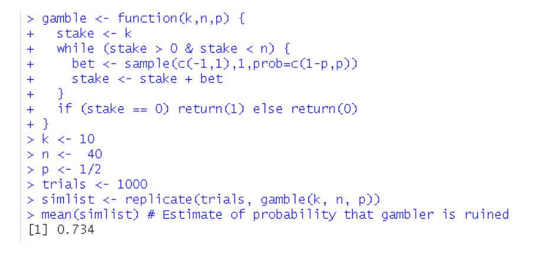
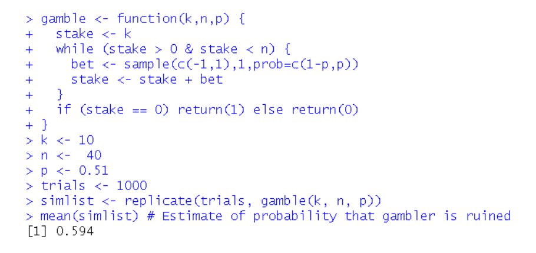

# Stochastic Processes (STAT-6379)


R simulations and written analyses from STAT-6379 Stochastic Processes, Spring 2023, University of Texas Rio Grande Valley (instructor: George Yanev).

Markov chains, branching processes, gambler's ruin, and extinction probabilities — simulated in R, with worked written solutions.

## Key Results

| Analysis | Headline result |
|---|---|
| Gambler's ruin, fair game (p = 0.50) | Simulated ruin probability **0.734** from 1,000 trials (k = 10, n = 40); exact value is 0.75 |
| Gambler's ruin, p = 0.51 | Simulated ruin probability **0.594** from 1,000 trials |
| Flood-insurance claims | P(claim) = **0.0235**; P(Texas \| claim) ≈ **0.17** |
| Coastal policyholders | P(claim) = **0.09** within five miles of the Atlantic coast |
| Forest ecosystem, state 1 → 12 | Expected time ≈ **10,821.68** five-year steps — about **54,108 years** |
| Branching-process extinction | Extinction probability estimated from **5,000** replicates; Bin(2, p) extinction probability p_e = (1 − p)²/p², capped at 1 |

## Simulation Output

Gambler's ruin simulation (Example 1.11), k = 10, n = 40, 1,000 trials — fair game, p = 0.50:



Same simulation with a slight edge, p = 0.51 — the ruin probability drops to 0.594:



## R scripts (`code/`)

| Script | What it does |
|---|---|
| `branching.R` | Branching-process simulation (Chapter 4): population size over generations under Poisson, geometric, and discrete (1/6, 1/3, 1/2) offspring distributions; estimates the extinction probability from 5,000 replicates and plots the extinction-probability curve for the geometric case. Note: the script redefines `branch()` once per offspring distribution, so the definition in effect at the end is the discrete one. |
| `extinction_probability.R` | Solves the generating-function quadratic for a branching-process extinction probability (`FUN_quad` evaluated at a = 1/4, b = −1/2, c = 1/4 — discriminant zero, repeated root 1), then plots the extinction probability p_e = (1 − p)²/p² (capped at 1) for a Bin(2, p) offspring distribution. Uses ggplot2 and data.table. |
| `forest_transition_matrix.R` | 12 × 12 transition matrix for forest ecosystem states (Strigul et al. 2012), modelling five-year changes; the same matrix used in the Assignment 5 absorption-time analysis. |
| `gamblers_ruin.R` | Example 1.11, gambler's ruin simulation: starting stake k = 10, playing until $40 or ruin, win probability p = 0.51, 1,000 trials, estimating the probability of ruin. For p = 0.5 the exact ruin probability is (n − k)/n = 0.75. |
| `hw2_transition_matrix.R` | 5-state transition matrix (states 80, 135, 139, 445, "No attack") with a recursive matrix-power function; computes the 2-, 12-, 13- and 90-step transition matrices starting from "No attack". |

## Written work (`report/`)

- `Readiness_Assessment.pdf` — Readiness assessment (Jan 26, 2023): Problem 1.2, flood-insurance conditional probability (P(claim) = 0.0235; P(Texas | claim) ≈ 0.17); Problem 1.4, policyholders within five miles of the Atlantic coast (P(claim) = 0.09); Problem 1.35 refers to the gambler's ruin simulation in `code/gamblers_ruin.R`.
- `Homework_5.docx` — Assignment 5 (due Feb 25, 2023), Exercise 3.64: expected time for the forest ecosystem to move from state 1 to state 12. With state 12 absorbing, the fundamental matrix gives ≈ 10,821.68 five-year steps from state 1 — about 54,108 years.

## How to Run

Source the scripts in R from the repository root:

```r
source("code/gamblers_ruin.R")
source("code/branching.R")
source("code/extinction_probability.R")
source("code/forest_transition_matrix.R")
source("code/hw2_transition_matrix.R")
```

The extinction-probability plot needs `ggplot2` and `data.table`:

```r
install.packages(c("ggplot2", "data.table"))
```

## Layout

```
stochastic-processes/
├── README.md
├── LICENSE
├── code/
│   ├── branching.R
│   ├── extinction_probability.R
│   ├── forest_transition_matrix.R
│   ├── gamblers_ruin.R
│   └── hw2_transition_matrix.R
├── images/
│   ├── gamblers-ruin-p050.png
│   └── gamblers-ruin-p051.png
└── report/
    ├── Readiness_Assessment.pdf
    └── Homework_5.docx
```
